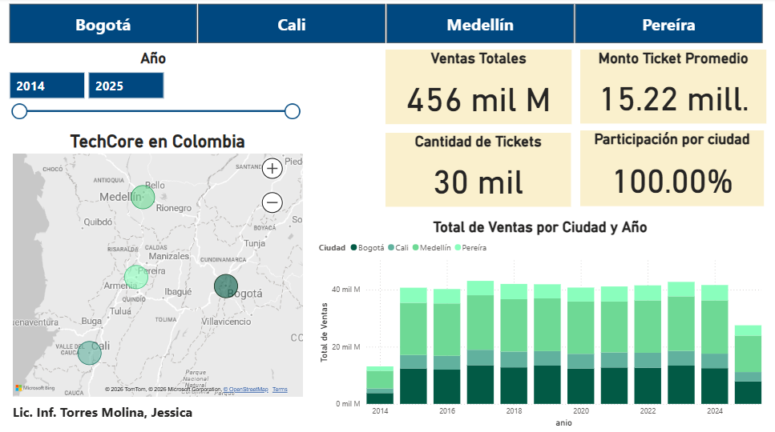
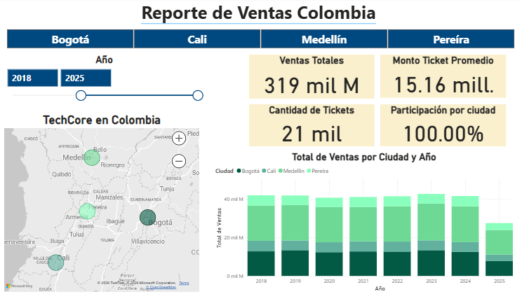
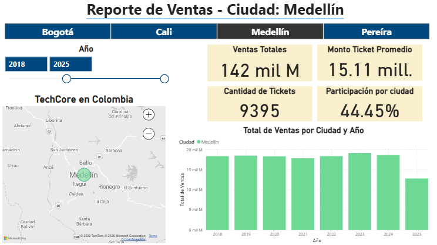
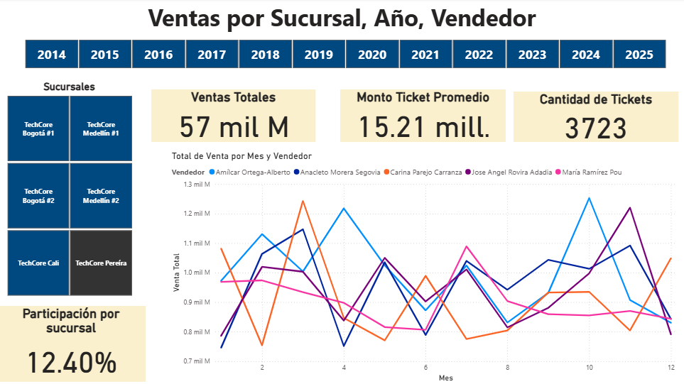
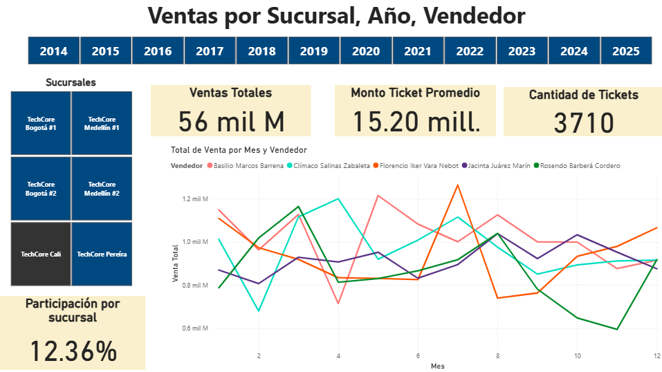
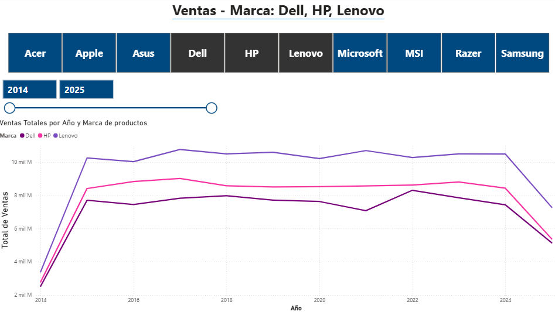
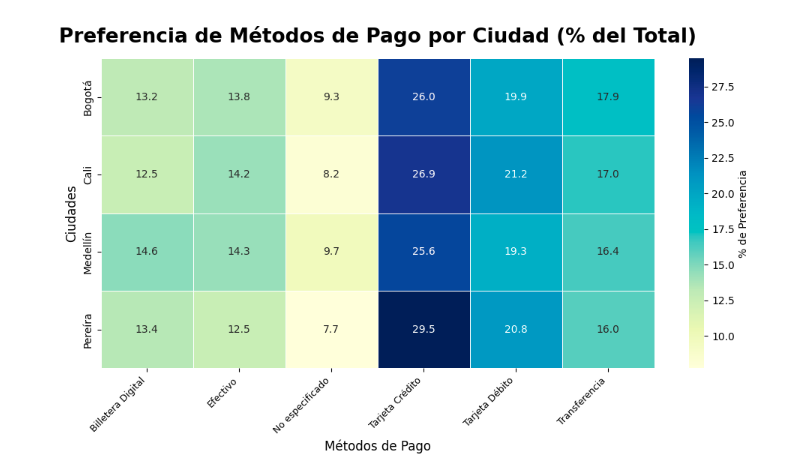
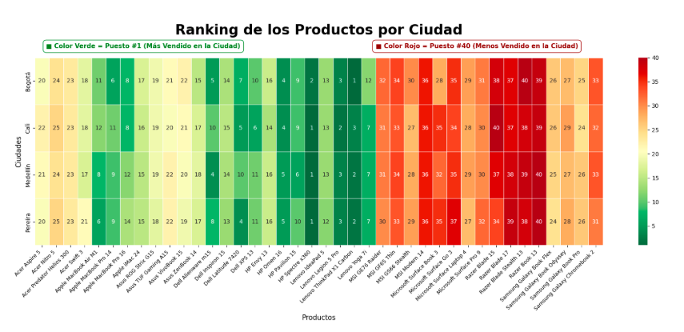

# Informe de gestión de ventas · Power BI + Python

Dashboard comparativo de gestión construido a partir de 10 años de ventas de una empresa con sucursales en varias ciudades. Los datos se recibieron en archivos CSV (productos, precios y medios de pago); los limpié y modelé con Python y armé el tablero en Power BI para responder preguntas de negocio sobre sucursales, productos y medios de pago.

> **Contexto:** caso práctico del curso de Data Science de Henry, proyecto individual.

## Problema de negocio

La empresa necesita un informe que detalle:

- la **rentabilidad de cada ciudad**
- la **rentabilidad de cada sucursal**
- el **ranking de marcas y productos** 
- los **medios de pago**.
> Para la toma de decisiones sobre la apertura o el cierre de sucursales, alianzas con marcas, productos a discontinuar entre otras.

## Datos

| Fuente | Contenido | Período |
| --- | --- | --- |
| Archivos CSV | Ventas con información de productos, precios y medios de pago, por sucursal y ciudad | 10 años |

> 30.000 registros, 6 sucursales y 40 productos

## Proceso

**1. Preparación de datos (ETL, Python y Power Query)**
- Importación de 1 archivo CSV
- Limpieza: Completitud de los datos, formatos de fechas entre otros
- Modelado relacional: Productos, Clientes, Sucursales, Facturas, Detalle de Facturas, Ciudades, Vendedores, Marcas y Método de Pago

**2. Análisis exploratorio (Python)**
- Análisis de ventas por sucursal, producto, marca y medio de pago con Pandas, Matplotlib y Seaborn
- Definición de indicadores clave (KPI)

**3. Dashboard (Power BI)**
- Tarjetas de KPI y vistas comparativas por sucursal, marca, producto y medio de pago
- Medidas en DAX: ventas totales, % participación por ciudad y por sucursal. 

## Hallazgos y recomendaciones

| Hallazgo | Recomendación |
| --- | --- |
| **Medellín lidera las ventas**: concentra el 44,45% del total y se mantiene estable a lo largo de los años | Consolidar y proteger la sucursal líder |
| **Pereira (12,4%) y Cali (12,35%)** generan bajas ganancias con poco porcentaje de participación en las ventas, no lograron una posición fuerte en los últimos 10 años | Realizar un estudio de mercado en la zona antes de decidir sobre su continuidad |
| **Las tarjetas de crédito y débito** son los medios de pago más usados; el efectivo es el menos usado | Lanzar campañas promocionales para reducir el uso de efectivo en los locales|
| **Los productos del puesto 35 al 40** son los de menor venta | Discontinuarlos y sumar productos similares a los productos más vendidos |

## Capturas del informe

**Total de ventas - 10 años**



**Medellín, líder en ventas**



**Participación y evolución de las ventas (44,45% del total, estable en el tiempo)**



**Pereira y Cali: sucursales de baja rentabilidad**




**Comparación de ventas por marca**



**Medios de pago**



**Ranking de productos**



## Estructura del repositorio

```text
management-report/
├── README.md
├── data/            # datos de muestra o descripción de las columnas
├── notebooks/       # limpieza y análisis exploratorio (Python)
├── powerbi/         # archivo .pbix del informe
└── images/          # capturas del dashboard
```

## Herramientas

- **Lenguaje:** Python
- **Análisis y visualización:** Pandas, Matplotlib, Seaborn
- **Business Intelligence:** Power BI, Power Query, DAX Studio

## Autora

**Lic. Inf. Jessica Torres Molina** · Consultora de datos · Power BI, SQL y Python
[LinkedIn](https://www.linkedin.com/in/jessicatorresmolina/) · [GitHub](https://github.com/jesitm)
